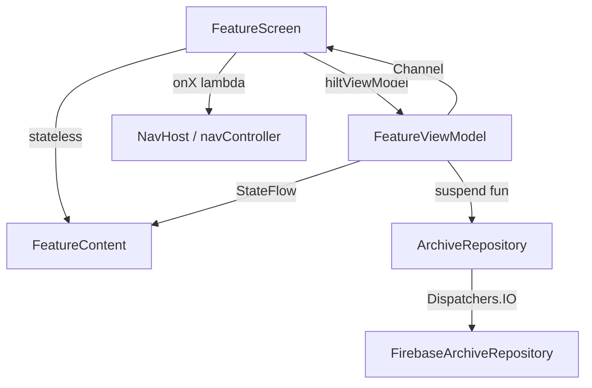

# Command: Document Module

Bir **feature paketini** (`feature/<ad>/`) ViFi-Android konvansiyonlarına göre dokümante eder: ekran (stateful `Screen` + stateless `Content`), `ViewModel`, `UiState`/`Event`, repository bağımlılıkları, route ve `testTag` sözleşmeleri.

> **Legacy not:** Kaynak iOS komutu `Sources/Scenes/<Modül>` altındaki `ViewController`/`View`/`ViewModel`/`Cell` dörtlüsünü dokümante eder. Android'de bu bir **feature paketidir** (`feature/<ad>/`: `Screen` + `Content` + `ViewModel` + `UiState`). Bugünkü v2.5 Java tarafında modül karşılığı `CourseExamListActivity`/`ExamDetailActivity` + `activity_*.xml` + `CustomAdapter`'dır; bu komut **hedef** mimariyi (Compose + MVVM + Hilt + named `vifi` Firestore) dokümante eder, eski `Activity`/XML'i değil. Göçteki yeri: `ANDROID-PARITY-ROADMAP.md` → Faz 1 (mimari iskelet).

## Usage

```
/document-module [feature_path]
```

## Arguments

- `feature_path`: Feature paketinin yolu (opsiyonel; verilmezse istenir)
  - Örnek: `feature/examlist`
  - Örnek: `app/src/main/java/com/salticusteam/vifi/feature/examdetail`

## What This Command Does

1. Feature paket yapısını tarar (`feature/<ad>/**` + ilişkili `core/**` dosyaları)
2. Dosyaları ve aralarındaki ilişkileri analiz eder (Screen → ViewModel → Repository)
3. Kapsamlı dokümantasyon üretir
4. Mimari diyagramı çizer (mermaid)
5. `docs/modules/` dizinine kaydeder

## Documentation Sections

### 1. Module Overview

- Amaç ve işlevsellik
- Feature sınıflandırması (ViFi domain kategorisi)
- Bağımlılıklar (repository arayüzleri, Hilt modülleri)

### 2. Architecture Diagram



### 3. File Inventory

| Dosya | Tür | Satır | Açıklama |
|-------|-----|-------|----------|
| {file} | {type} | {count} | {description} |

### 4. Data Flow

- Kullanıcı etkileşimleri (Composable → `viewModel::onX`)
- Repository çağrıları (`viewModelScope.launch` + `Dispatchers.IO`)
- State değişimleri (`MutableStateFlow` güncellemeleri)
- Tek seferlik olaylar (`Channel`/`SharedFlow` → `LaunchedEffect`)

### 5. Navigation

- Route hedefleri (`ViFiRoute`, type-safe)
- `ModalBottomSheet` sunumları
- Navigation-Compose bağlama (`NavHost` → `composable<Route>`)

### 6. Dependencies

- Kullanılan repository arayüzleri
- Hilt modülleri / `@Provides`
- `strings.xml` anahtarları
- `core/designsystem` (renk/tipografi) kullanımı

## Output Format

```markdown
# {ModuleName} Module Documentation

## Overview
{Bu modülün ne yaptığının kısa açıklaması}

**Feature Category**: {Arşiv/Browse|Katkı|Kimlik|Kullanıcı}
**Created**: {git'ten ilk commit tarihi}
**Last Modified**: {git'ten son commit tarihi}

## Architecture

```mermaid
graph TD
    subgraph Presentation Layer
        Screen[{Name}Screen]
        Content[{Name}Content]
        Item[{Item}ListItem]
    end

    subgraph Business Logic
        VM[{Name}ViewModel]
        State[{Name}UiState]
        Event[{Name}Event]
    end

    subgraph Data Layer
        Repo[ArchiveRepository]
        FbRepo[FirebaseArchiveRepository]
        Fake[FakeArchiveRepository]
    end

    subgraph DI (Hilt)
        Module[RepositoryModule]
    end

    Screen --> |hiltViewModel| VM
    Screen --> |state + lambda| Content
    Content --> |items| Item
    VM --> |StateFlow| State
    VM --> |Channel one-shot| Event
    VM --> |constructor inject| Repo
    Module --> |@Binds| FbRepo
    FbRepo --> |implements| Repo
    Fake --> |implements| Repo
    FbRepo --> |Task.await / callbackFlow| Firestore
```

## Files

### Screen (stateful)
**File**: `{Name}Screen.kt` ({lines} satır)

**Pattern**: Stateful entry Composable
- ViewModel: `hiltViewModel()` ile `{Name}ViewModel` alır
- State: `collectAsStateWithLifecycle()` ile `uiState` toplar
- Events: `LaunchedEffect` içinde `viewModel.events` dinler
- Navigasyonu `onX: () -> Unit` lambda'ları ile dışarı verir (içinde `NavController` tutmaz)

**Key Points**:
- `@Composable fun {Name}Screen(onExamClick, onBack, viewModel = hiltViewModel())`
- `LaunchedEffect(Unit) { viewModel.events.collect { ... } }` — tek seferlik olay köprüsü
- Stateless `{Name}Content`'e state + lambda aktarır

**Navigation (dışarı verilen niyetler)**:
- Push: {route hedefleri listesi}
- Present: {ModalBottomSheet listesi}

### Content (stateless)
**File**: `{Name}Content.kt` ({lines} satır)

**Pattern**: Stateless, `@Preview`lenebilir Composable
- Yalnızca `state: {Name}UiState` + lambda parametreleri alır
- `ViewModel`/`NavController` referansı **içermez**
- Kök `Scaffold` + `TopAppBar` (geri butonu `navigationIcon`)

**UI Elements**:
- {LazyColumn/LazyVerticalGrid, kart, buton vb. listesi}

**State Handling**:
- `state.isLoading` → `LoadingView`
- `state.error != null` → `ErrorView(message = state.error, onRetry = ...)`
- aksi halde → içerik listesi

### ViewModel
**File**: `{Name}ViewModel.kt` ({lines} satır)

**Pattern**: `@HiltViewModel` + `StateFlow<UiState>` + `Channel<Event>`

```kotlin
@HiltViewModel
class {Name}ViewModel @Inject constructor(
    private val archiveRepository: ArchiveRepository
) : ViewModel() {

    // State
    private val _uiState = MutableStateFlow({Name}UiState())
    val uiState: StateFlow<{Name}UiState> = _uiState.asStateFlow()

    // One-shot events
    private val _events = Channel<{Name}Event>(Channel.BUFFERED)
    val events = _events.receiveAsFlow()

    // Internal state
    private var loadJob: Job? = null

    // Intents
    fun onExamSelected(examId: String) { /* ... */ }
    fun onRetry() { load() }
}
```

**Intents (public fonksiyonlar)**:
- `onExamSelected(examId: String)` — satıra tıklama
- `onRetry()` — hatadan sonra yeniden yükleme
- {diğer intent'ler}

**Repository erişimi**:
- Enjekte edilen: `ArchiveRepository` (constructor injection)
- Çağrılar: `archiveRepository.getExams(...)`, `archiveRepository.observeExams(...)`
- Thread: `viewModelScope.launch` + repository `Dispatchers.IO`

### UiState & Event
**File**: `{Name}UiState.kt` ({lines} satır)

**Pattern**: Tek immutable `data class` + `sealed interface` Event

```kotlin
data class {Name}UiState(
    val exams: List<Exam> = emptyList(),
    val isLoading: Boolean = false,
    val error: String? = null          // ArchiveError.userMessage (Türkçe)
)

sealed interface {Name}Event {
    data class OpenExam(val examId: String) : {Name}Event
    data class ShowMessage(val text: String) : {Name}Event
}
```

**Properties**:
- `exams: List<Exam>` — ekranda gösterilen domain modelleri
- `isLoading: Boolean` — yükleme bayrağı
- `error: String?` — gösterilecek Türkçe hata (`ArchiveError.userMessage`)

### ListItem (opsiyonel)
**File**: `{Item}ListItem.kt` ({lines} satır)

**Pattern**: Stateless liste satırı Composable
- Girdi: `exam: Exam` + `onClick: () -> Unit` (iOS `configure(with:)` karşılığı)
- `Modifier.testTag("examList.item.${exam.id}")`

## Data Flow

### Initial Load
1. `{Name}Screen` composition'a girer → `collectAsStateWithLifecycle()` state'e abone olur
2. `LaunchedEffect(Unit)` ViewModel'in `load()`'unu tetikler (veya `init {}`)
3. ViewModel `_uiState.update { it.copy(isLoading = true) }`
4. `viewModelScope.launch { archiveRepository.getExams(lessonId) }` çağrılır (repo içi `Dispatchers.IO`)
5. Başarı: `_uiState.update { it.copy(exams = result, isLoading = false) }` → Content yeniden çizilir
6. Hata: `catch (e: ArchiveError) { _uiState.update { it.copy(error = e.userMessage, isLoading = false) } }`

### Pull-to-Refresh
1. Kullanıcı aşağı çeker → Material3 `PullToRefreshBox` `onRefresh` tetikler
2. `viewModel.onRefresh()` çağrılır
3. ViewModel listeyi sıfırlayıp taze veri çeker (`getExams(..., forceRefresh = true)`)
4. `_uiState.update { it.copy(isRefreshing = false, exams = fresh) }`

### Pagination / Canlı Dinleyici
1. `LazyColumn` sona yaklaşınca (veya `callbackFlow` yeni snapshot yayınlar)
2. One-shot read'de: `onLoadMore()` → `getExams(page = next)` → listeye `+` ile eklenir
3. Canlı dinleyicide: repository `callbackFlow { ... awaitClose { ref.removeEventListener(l) } }` yayınladıkça `collect` state'i günceller
4. Her iki yolda da ham Firebase tipi değil, domain `List<Exam>` akar

### Navigation
1. Kullanıcı satıra dokunur → `onExamClick(exam.id)` (Content lambda'sı) → `viewModel.onExamSelected(id)`
2. ViewModel `_events.send({Name}Event.OpenExam(id))`
3. `Screen` içindeki `LaunchedEffect` olayı yakalar → `onExamClick(event.examId)` üst lambda'yı çağırır
4. `NavHost` lambda'yı `navController.navigate(ViFiRoute.ExamDetail(examId))`'e bağlar
5. Geri: `TopAppBar` `navigationIcon` → `onBack()` → `navController.popBackStack()`

## Firebase Data Integration

### Repository Arayüzü
**File**: `core/data/repository/ArchiveRepository.kt`

```kotlin
interface ArchiveRepository {
    suspend fun getExams(lessonId: String): List<Exam>
    fun observeExams(lessonId: String): Flow<List<Exam>>
    suspend fun getExamDetail(examId: String): Exam
}
```

### Canlı Implementasyon
**File**: `core/data/repository/FirebaseArchiveRepository.kt`

- Named `vifi` Firestore'dan okur (`FirebaseFirestore.getInstance(app, "vifi")`)
- `Task<QuerySnapshot>.await()` (kotlinx-coroutines-play-services) veya `callbackFlow`
- `ExamDto` → `Exam` map eder; ham `DocumentSnapshot`/`FirebaseFirestoreException` **sızdırmaz**
- Hataları `ArchiveError` + Türkçe `userMessage`'a çevirir

### Fake Implementasyon
**File**: `core/data/repository/FakeArchiveRepository.kt`

- `@Preview` ve birim/UI testleri için (iOS Mock karşılığı)
- Sabit domain verisi döner; Firebase'e dokunmaz

### Models

**Domain**: `core/model/Exam.kt`
- Plain `data class Exam(val id, val lessonId, val year, ...)`
- UI ve ViewModel yalnızca bunu görür

**DTO**: `core/data/dto/ExamDto.kt`
- Firestore decode tipi (`@DocumentId`, nullable alanlar)
- `toDomain()` ile `Exam`'a map edilir; repository sınırının içinde kalır

## Dependencies

### Internal

**Repository arayüzleri**:
- `ArchiveRepository` — arşiv okuma yüzeyi
- `AuthRepository` — oturum/kullanıcı (gerekiyorsa)

**Hilt**:
- `RepositoryModule` — `@Binds` ile `FirebaseArchiveRepository` → `ArchiveRepository`
- `FirebaseModule` — named `vifi` Firestore + Storage sağlar

**Design system**:
- `core/designsystem/Color.kt` — marka renkleri (`MaterialTheme.colorScheme`)
- `core/designsystem/Type.kt` — tipografi (`MaterialTheme.typography`)
- `core/designsystem/Theme.kt` — `ViFiTheme`

**Navigation**:
- `core/navigation/ViFiRoute.kt` — type-safe route'lar
- `core/navigation/ViFiNavHost.kt` — `NavHost` bağlama

### External

**Kütüphaneler** (Firebase BoM + version catalog):
- Jetpack Compose + Material3 — UI
- Hilt — DI
- Kotlin Coroutines + Flow — async
- Firebase Firestore / Storage — veri (`vifi-831a8`, named `vifi` DB)
- kotlinx-coroutines-play-services — `Task.await()`
- Coil — görsel yükleme (iOS Kingfisher karşılığı)

### Repositories Used

- `ArchiveRepository` — bu modülün ana veri kaynağı

### String Keys

- `{feature}_title`, `{feature}_empty`, `{feature}_error_generic` — `res/values/strings.xml`
- Placeholder'lar positional: `%1$s` / `%1$d` (`stringResource(R.string.x, arg)`)

## Usage Example

### Navigate to Module

```kotlin
// NavHost içinde route bağlama
composable<ViFiRoute.ExamList> { backStackEntry ->
    val route = backStackEntry.toRoute<ViFiRoute.ExamList>()
    ExamListScreen(
        onExamClick = { examId -> navController.navigate(ViFiRoute.ExamDetail(examId)) },
        onBack = { navController.popBackStack() }
    )
}
```

### With Dependency Injection (route argümanı)

```kotlin
// Argüman type-safe route alanıyla taşınır; PII route string'ine gömülmez
sealed interface ViFiRoute {
    @Serializable data class ExamList(val lessonId: String) : ViFiRoute
}

// Hedef ViewModel argümanı SavedStateHandle'dan okur
@HiltViewModel
class ExamListViewModel @Inject constructor(
    private val archiveRepository: ArchiveRepository,
    savedStateHandle: SavedStateHandle
) : ViewModel() {
    private val lessonId = savedStateHandle.toRoute<ViFiRoute.ExamList>().lessonId
}
```

### Present as Bottom Sheet

```kotlin
// iOS BottomSheetManager karşılığı: Material3 ModalBottomSheet
if (showUnlockSheet) {
    ModalBottomSheet(onDismissRequest = { showUnlockSheet = false }) {
        UnlockExamContent(
            cost = state.unlockCost,
            onConfirm = viewModel::onUnlockConfirmed
        )
    }
}
```

## Testing

### Unit Tests
**File**: `src/test/java/com/salticusteam/vifi/feature/{ad}/{Name}ViewModelTest.kt`

**Coverage**:
- ViewModel intent → `uiState` geçişleri (JUnit + `runTest` + Turbine)
- One-shot `Event` yayını (Turbine ile `events` doğrulama)
- Repository hatası → `uiState.error` (Türkçe `userMessage`)
- DTO→domain map doğruluğu
- Repository yerine `FakeArchiveRepository`; gerektiğinde MockK

### UI Tests
**File**: `src/androidTest/java/com/salticusteam/vifi/feature/{ad}/{Name}ScreenTest.kt`

**Coverage**:
- Ekran öğeleri görünür (`onNodeWithTag("examList.screen")`)
- Pull-to-refresh çalışır
- Satıra tıklama navigasyon lambda'sını tetikler
- Hata durumu + retry (`onNodeWithTag("examList.retryButton").performClick()`)
- `createAndroidComposeRule` + `onNodeWithTag` + `performClick`

### Mocks / Fakes
- `FakeArchiveRepository` — repository'yi testte besler (iOS Mock karşılığı)
- `@Preview` fonksiyonları `FakeArchiveRepository` ile dolu `UiState` gösterir

## testTag Sözleşmeleri

> `testTag`'ler UI testleriyle **sözleşmedir** — mevcutları değiştirme (iOS accessibility identifier karşılığı). Kalıp: `"<ekran>.<öğe>"`.

| testTag | Öğe |
|---------|-----|
| `examList.screen` | Kök Scaffold / ekran |
| `examList.list` | `LazyColumn`/`LazyVerticalGrid` |
| `examList.item.${exam.id}` | Liste satırı |
| `examList.loading` | Yükleme göstergesi |
| `examList.error` | Hata view |
| `examList.retryButton` | Yeniden dene butonu |
| `examList.backButton` | TopAppBar geri ikonu |

## Maintenance Notes

### Common Tasks

**UI'ya yeni alan ekle**:
1. `core/data/dto/ExamDto.kt`'e alanı ekle (+ `toDomain()` map)
2. `core/model/Exam.kt`'e alanı ekle (`// Added in <versionName> — <amaç>.` yorumuyla)
3. `{Name}UiState`'i gerekiyorsa genişlet
4. `{Item}ListItem` / `{Name}Content`'te göster (`MaterialTheme.typography`, `stringResource`)

**Yeni Firebase sorgusu ekle**:
1. `ArchiveRepository` arayüzüne `suspend fun`/`Flow` imzası ekle
2. `FirebaseArchiveRepository`'de implement et (`await()`/`callbackFlow`, DTO→domain)
3. `FakeArchiveRepository`'de karşılığını ekle
4. ViewModel'de `viewModelScope.launch` ile çağır; hatayı `ArchiveError`'a çevir

**Yeni navigasyon hedefi ekle**:
1. `ViFiRoute`'a yeni route (`@Serializable data class/object`) ekle
2. `ViFiNavHost`'a `composable<ViFiRoute.X>` bağla
3. `Screen`'e `onX: () -> Unit` lambda'sı ekle; ViewModel `Channel<Event>` ile yayınla

### Known Issues
{bilinen sorunlar / teknik borç}

### Future Improvements
{planlanan iyileştirmeler}

## Architecture Compliance

✅ **Uyumlu**:
- MVVM (`@HiltViewModel` + `StateFlow<UiState>`)
- Stateful `Screen` / stateless `Content` ayrımı
- Repository arayüzü + Firebase impl + Fake
- Navigation-Compose (type-safe route + `popBackStack`)
- Coroutines/Flow (`viewModelScope` + `Dispatchers.IO`)
- `stringResource` + `MaterialTheme` (hardcoded yok)
- `testTag` sözleşmeleri

❌ **Kullanmaz** (tasarım gereği):
- `Activity`/`Fragment`/XML yeni ekranda (legacy istisna)
- `LiveData`/RxJava
- Delegate-based ViewModel / Output enum
- Ham Firebase tipi UI/ViewModel sızıntısı
- ViewModel'de `Context` (`@ApplicationContext` hariç) / `NavController`
- AdMob (parite için kaldırıldı)

---

**Generated**: {date}
**Module Path**: `{path}`
**Total Files**: {count}
**Total Lines**: {count}
```

## Example Output

```
User: /document-module feature/examlist

Output:
# ExamList Module Documentation

## Overview
Seçili dersin (Lesson) sınav arşivini listeler. Kullanıcı yıllara göre
sıralı sınavları görür, bir satıra dokununca sınav detayına (PDF + coin
kilidi) gider.

**Feature Category**: Arşiv/Browse
**Created**: 2026-02-10
**Last Modified**: 2026-03-04

## Architecture
[Mermaid: ExamListScreen → ExamListViewModel → ArchiveRepository;
 ExamListScreen → ExamListContent; RepositoryModule @Binds FirebaseArchiveRepository]

## Files

### Screen (stateful)
**File**: `ExamListScreen.kt` (62 satır)
- ViewModel: `hiltViewModel<ExamListViewModel>()`
- State: `collectAsStateWithLifecycle()`
- Events: `LaunchedEffect` → `onExamClick` / `onBack`

### Content (stateless)
**File**: `ExamListContent.kt` (118 satır)
- `Scaffold` + `TopAppBar` (geri `navigationIcon`)
- `LazyColumn` + `ExamListItem` (`testTag("examList.item.${exam.id}")`)

### ViewModel
**File**: `ExamListViewModel.kt` (94 satır)
- `@HiltViewModel`, `StateFlow<ExamListUiState>`, `Channel<ExamListEvent>`
- Intents: `onExamSelected(examId)`, `onRetry()`
- Repository: `ArchiveRepository.getExams(lessonId)`

### UiState & Event
**File**: `ExamListUiState.kt` (28 satır)
- `data class ExamListUiState(exams, isLoading, error)`
- `sealed interface ExamListEvent { OpenExam }`

## Firebase Data Integration
- Repository: `ArchiveRepository` (impl `FirebaseArchiveRepository`, fake `FakeArchiveRepository`)
- Model: `Exam` (domain) ← `ExamDto` (Firestore named `vifi`)

## Dependencies
- ArchiveRepository (arşiv okuma)
- Hilt (RepositoryModule, FirebaseModule)
- Compose/Material3, Coroutines/Flow, Coil

---

**Generated**: 2026-03-15
**Module Path**: `feature/examlist`
**Total Files**: 5
**Total Lines**: 302
```

## Output Location

Dokümantasyon otomatik olarak şuraya kaydedilir:
```
docs/modules/{ModuleName}Module.md
```

## Related Commands

- `/check-architecture` — modül uyumluluğunu denetle (sınır ihlali / ham Firebase tipi sızıntısı / hardcoded string taraması)
- `/scaffold-feature` — yeni feature modülü iskeleti üret
- `/generate-mocks` — modül için `Fake...Repository` üret

## Ayrıca Bakınız

- `.claude/rules/architecture.md` — ViFi-Android hedef mimarisi (MVVM + Hilt + Repository + Navigation-Compose)
- `.claude/rules/viewmodel-rule.md` — ViewModel/UiState/StateFlow/Event kuralları
- `.claude/rules/firebase-data.md` — Repository, DTO→domain map, `callbackFlow`, `ArchiveError`
- `.claude/rules/ui-components.md` — Compose/Material3 ekran bileşenleri, geri butonu, `testTag`
- `.claude/rules/localization.md` — `strings.xml`, `stringResource`, positional args
- `.claude/rules/testing.md` — `runTest`/Turbine/Fake birim + Compose UI test desenleri
- `.claude/skills/new-feature/` — tam feature modülü iskeleti (dokümante edilenin üretici karşılığı)
- `.claude/skills/review-pr/` — PR denetimi (dokümantasyonu gözden geçirme)

---
